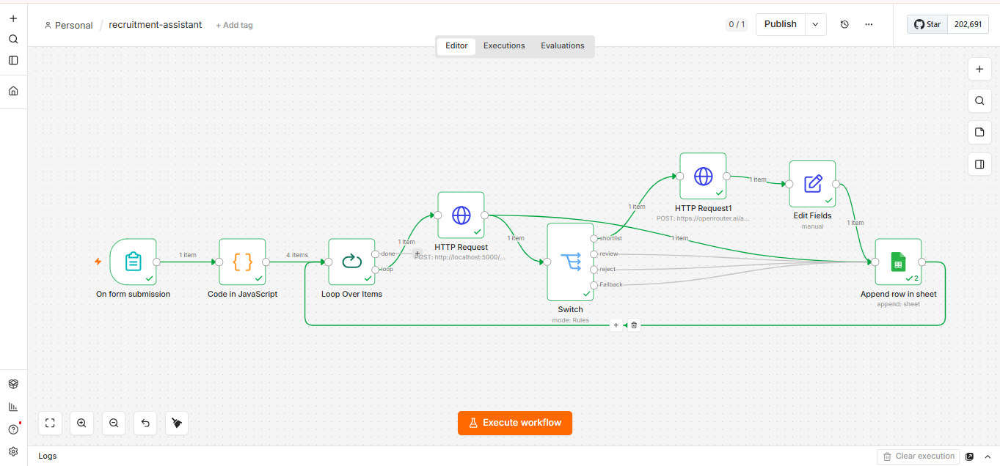

# AI Recruitment Assistant

Screens candidate resumes against a job description using retrieval-augmented
generation, then routes each candidate to an action based on the verdict.

Python · ChromaDB · Sentence Transformers · Flask · n8n · Google Sheets



## How it works

A recruiter submits a job spec and a batch of resumes through an n8n form.
For each candidate:

1. The resume is parsed (PDF, DOCX or TXT) and split into overlapping chunks
2. Chunks are embedded locally with MiniLM and stored in ChromaDB
3. **The job spec is used as the search query** — retrieval surfaces the resume
   sections most relevant to what's being hired for
4. Those sections go to an LLM, which returns a structured verdict:
   shortlist / review / reject, with a score, reasoning, evidence and gaps
5. Shortlisted candidates get an outreach email drafted automatically
6. Every candidate is logged to Google Sheets

Embeddings run on the machine, so resumes never leave it. Only the retrieved
excerpts are sent to the LLM.

## Why retrieval alone isn't enough

Retrieval finds relevant text. It can't judge whether that text meets a
requirement. Screening four candidates against a Python developer spec:

| Candidate | Retrieval rank | LLM rank |
|---|---|---|
| Backend engineer | 1 | 1 |
| **Graphic designer** | **3** | **4** |
| **Data analyst** | **4** | **3** |

Similarity search ranked a graphic designer *above* a data analyst — her skills
section is a dense list of tool names, which structurally resembles a job spec,
while his experience is written as prose. Cosine similarity measures topical
overlap, not capability.

The LLM layer corrected it: the designer scored 10/100 with every requirement
listed as a gap; the analyst scored 45/100 with "no evidence of REST APIs" as
the specific reason. That distinction is why the evaluation step exists rather
than thresholding on similarity score.

## Files

| File | Role |
|---|---|
| `pipeline.py` | document loading, chunking, embeddings, ChromaDB |
| `screen.py` | job spec as query, per-candidate retrieval |
| `evaluate.py` | LLM evaluation, structured JSON verdicts |
| `api.py` | Flask endpoints the n8n workflow calls |
| `workflow.json` | the n8n workflow (import into n8n) |

## Running it

```bash
python -m venv .venv
.venv\Scripts\activate
pip install -r requirements.txt
```

Create `.env`:

```
OPENROUTER_API_KEY=your-key-here
```

Start the API:

```bash
python api.py
```

Import `workflow.json` into n8n, add your Google Sheets credential, and open
the form URL.

To screen a folder of resumes from the terminal instead, put them in
`documents/` and run `python evaluate.py`.

## Design notes

**Local embeddings, hosted LLM.** Embedding runs on every chunk of every
resume — high volume, but a simple task a 90 MB model handles well. Evaluation
runs once per candidate and needs real reasoning. Matching model size to the job
keeps cost down and keeps documents on-device.

**Unverifiable is not the same as missing.** An early version rejected a
candidate whose resume evidenced every required skill but never stated total
years of experience. A missing skill is a gap; an unstated duration is
incomplete information. The prompt now routes the second case to `review` for a
human rather than auto-rejecting.

**Failures degrade to `review`.** If the LLM call fails or returns unparseable
output, the candidate is marked for human review with the reason recorded,
rather than crashing the batch or being silently dropped.

## Known limitations

- n8n's form field replaces the selection when files are picked one at a time;
  users must select the whole batch at once
- DOCX and TXT have no page structure, so citations for those are page 1
- Free-tier LLM rate limits mean large batches need a delay between calls